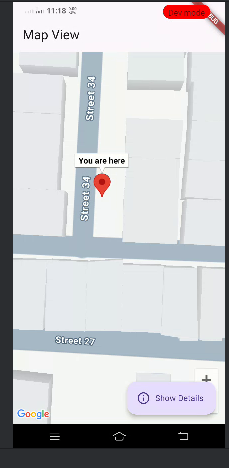
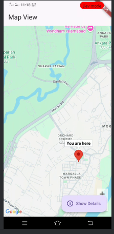
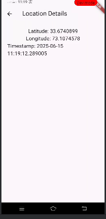

<div align="center">

  <h1>📍 Real-Time Location Tracker</h1>
  <p><strong>A sleek, real-time geolocation tracking mobile app built with Flutter and Google Maps</strong></p>

  <p>
    <a href="https://flutter.dev"></a>
    <a href="https://dart.dev"></a>
    <a href="https://developers.google.com/maps"></a>
    <a href="#"></a>
    <a href="LICENSE"></a>
  </p>

</div>

---

## 📖 Overview

**Real-Time Location Tracker** is a Flutter mobile application designed to detect, track, and display the device's precise geographical location in real-time. Featuring direct integration with **Google Maps SDK** and hardware GPS location providers, the app smoothly transitions from street-level views to an informative telemetry detail screen showing latitude, longitude, and timestamps.

---

## 📱 Screenshots Showcase

<div align="center">
  <table>
    <tr>
      <td align="center" width="33%">
        <strong>📍 Street-Level Map</strong><br/><br/>
        <br/><br/>
        <em>Interactive marker pinpointing current location with floating quick actions</em>
      </td>
      <td align="center" width="33%">
        <strong>🗺️ Geographic Area Map</strong><br/><br/>
        <br/><br/>
        <em>Zoom controls, gestures, and fluid camera navigation across the region</em>
      </td>
      <td align="center" width="33%">
        <strong>📊 Location Details</strong><br/><br/>
        <br/><br/>
        <em>Exact coordinates (Latitude, Longitude) & precise real-time timestamp</em>
      </td>
    </tr>
  </table>
</div>

---

## ✨ Features

- 🛰️ **Real-Time GPS Tracking**: Seamlessly requests and fetches high-accuracy location data using device GPS.
- 🗺️ **Interactive Google Maps**: Fully interactive map view featuring custom markers ("You are here"), camera animations, and pinch-to-zoom.
- 🛡️ **Runtime Permission Handling**: Gracefully prompts users for device location services and permissions.
- 📋 **Telemetry Detail View**: Clean Material design screen presenting formatted latitude, longitude, and timestamp.
- 🔒 **Secure Secrets Management**: Integrates Google Maps Secrets Gradle Plugin to avoid hardcoding sensitive API credentials in version control.
- ⚡ **Cross-Platform Foundation**: Built on Flutter for fluid 60 FPS performance on both Android and iOS devices.

---

## 🛠️ Tech Stack & Dependencies

| Layer | Technology | Purpose |
| :--- | :--- | :--- |
| **Framework** | [Flutter](https://flutter.dev/) (Dart SDK `^3.8.0`) | Cross-platform UI toolkit |
| **Mapping Engine** | [`google_maps_flutter`](https://pub.dev/packages/google_maps_flutter) (`^2.10.1`) | Google Maps widgets and controls |
| **Geolocation** | [`location`](https://pub.dev/packages/location) (`^6.0.2`) | Real-time GPS location handling & permission checks |
| **Icons** | [`cupertino_icons`](https://pub.dev/packages/cupertino_icons) (`^1.0.8`) | iOS and Material styled icons |
| **Secrets Engine** | `secrets-gradle-plugin` (`2.0.1`) | Gradle plugin for secure API key injection |

---

## 📂 Project Structure

```text
Current Location tracker Mobile App/
├── android/                         # Android native configurations & build files
│   ├── app/
│   │   ├── build.gradle.kts         # Secrets Gradle plugin & app build rules
│   │   └── src/main/AndroidManifest.xml # Permissions & Google Maps meta-data
│   ├── secrets.properties.example   # Template for Google Maps API Key
│   └── local.defaults.properties    # Default fallback properties
├── assets/                          # App screenshots & visual documentation
│   ├── 1.png                        # Street-level live map screenshot
│   ├── 2.png                        # Wide overview map screenshot
│   └── 3.png                        # Location details screen screenshot
├── ios/                             # iOS native configurations
│   └── Runner/Info.plist            # iOS location permission strings
├── lib/                             # Core Flutter source code
│   └── main.dart                    # Application entry point, MapScreen, & DetailScreen
├── test/                            # Unit & widget tests
│   └── widget_test.dart             # Smoke & widget tests
├── pubspec.yaml                     # Dependencies and package metadata
└── README.md                        # Project documentation
```

---

## 🚀 Getting Started

### 📋 Prerequisites

Ensure you have the following installed on your machine:
- [Flutter SDK](https://docs.flutter.dev/get-started/install) (`>= 3.8.0`)
- [Dart SDK](https://dart.dev/get-dart)
- [Android Studio](https://developer.android.com/studio) or [VS Code](https://code.visualstudio.com/) with Flutter extensions
- A physical Android/iOS device or an emulator with Google Play Services
- A **Google Cloud Platform (GCP)** account with Maps SDK enabled

---

### 🔑 Google Maps API Key Setup

1. Head over to the [Google Cloud Console](https://console.cloud.google.com/).
2. Create a new project (or select an existing one).
3. Navigate to **APIs & Services > Library** and enable:
   - **Maps SDK for Android** (for Android)
   - **Maps SDK for iOS** (for iOS)
4. Generate an API Key under **APIs & Services > Credentials**.
5. *(Recommended)* Restrict your API key to your application package name (`com.example.assignemnt4`) and SHA-1 fingerprint for production safety.

---

### ⚙️ Installation & Running

1. **Clone the repository:**
   ```bash
   git clone https://github.com/t-kiran-05/Real-Time-Location-tracker-Mobile-App.git
   cd Real-Time-Location-tracker-Mobile-App
   ```

2. **Install Flutter dependencies:**
   ```bash
   flutter pub get
   ```

3. **Configure your API Key (Android):**
   Copy the example secrets file:
   ```bash
   cp android/secrets.properties.example android/secrets.properties
   ```
   Open `android/secrets.properties` and paste your actual Google Maps API key:
   ```properties
   MAPS_API_KEY=AIzaSyYourActualGoogleMapsApiKeyHere
   ```
   > ℹ️ *`secrets.properties` is already included in `.gitignore` to prevent exposing your private key.*

4. **Run the application:**
   ```bash
   flutter run
   ```

---

## 🔐 Permissions & Native Configuration

### Android (`android/app/src/main/AndroidManifest.xml`)
The following location permissions are pre-configured:
```xml
<uses-permission android:name="android.permission.ACCESS_FINE_LOCATION"/>
<uses-permission android:name="android.permission.ACCESS_COARSE_LOCATION"/>

<application ...>
    <meta-data
        android:name="com.google.android.geo.API_KEY"
        android:value="${MAPS_API_KEY}" />
</application>
```

### iOS (`ios/Runner/Info.plist`)
For iOS deployments, ensure the following keys are present in `Info.plist`:
```xml
<key>NSLocationWhenInUseUsageDescription</key>
<string>This app requires access to your location to display your position on the map.</string>
<key>NSLocationAlwaysUsageDescription</key>
<string>This app requires location access to track real-time coordinates.</string>
```

---

## 💡 Troubleshooting & Tips

- **Map appears blank / Gray tiles:**
  - Verify that the **Maps SDK for Android** is enabled in the Google Cloud Console.
  - Verify your API Key in `android/secrets.properties`.
  - Ensure your device/emulator has internet access.
- **Location does not update:**
  - Ensure Location/GPS is turned ON in device settings.
  - Grant location permissions when prompted by the app.
- **Gradle build fails on secrets:**
  - Ensure `android/secrets.properties` or `android/local.defaults.properties` exists.

---

## 🤝 Contributing

Contributions, issues, and feature requests are welcome!
1. Fork the Project
2. Create your Feature Branch (`git checkout -b feature/AmazingFeature`)
3. Commit your Changes (`git commit -m 'feat: add some AmazingFeature'`)
4. Push to the Branch (`git push origin feature/AmazingFeature`)
5. Open a Pull Request

---

## 📄 License

Distributed under the [MIT License](LICENSE). Feel free to use and modify for personal and educational projects.
